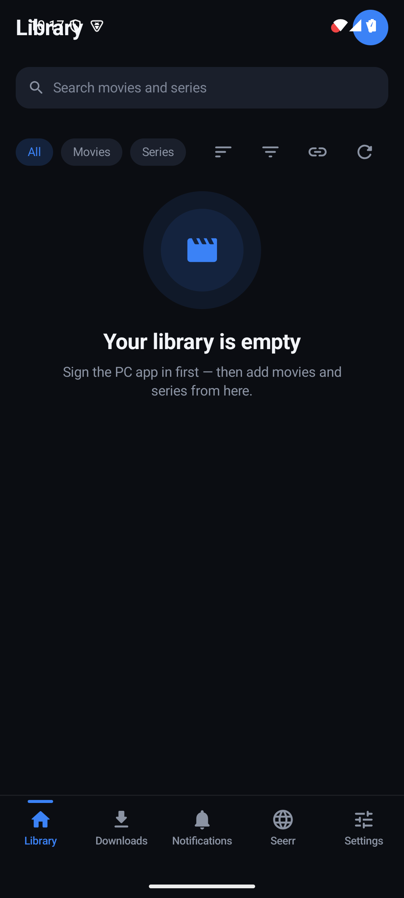
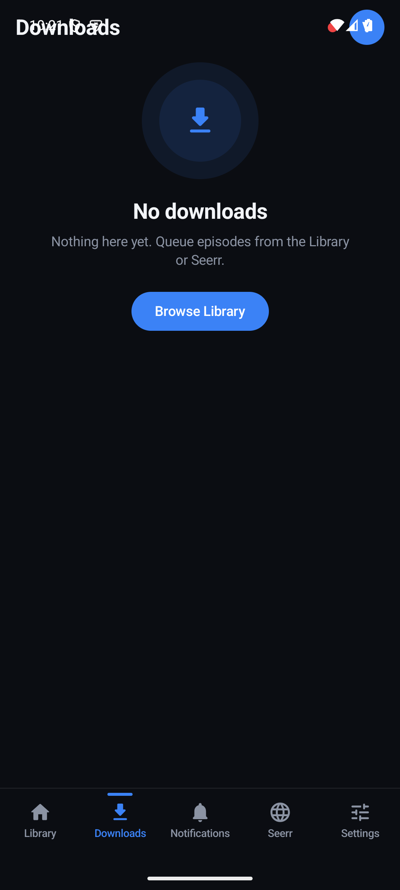
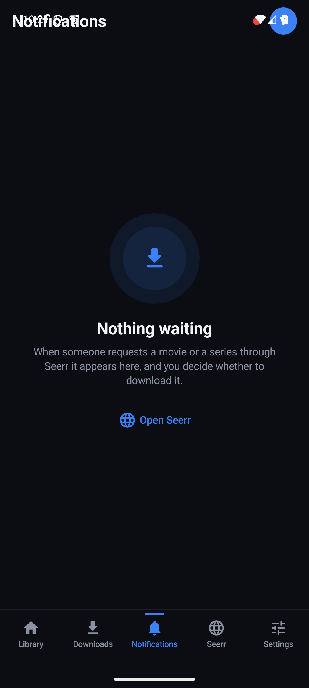
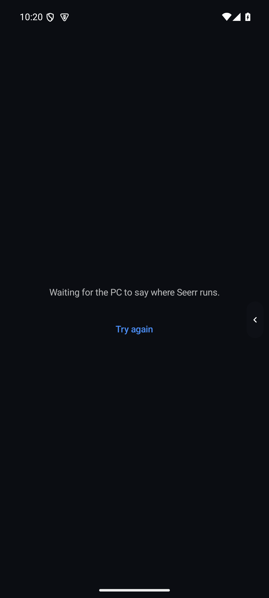
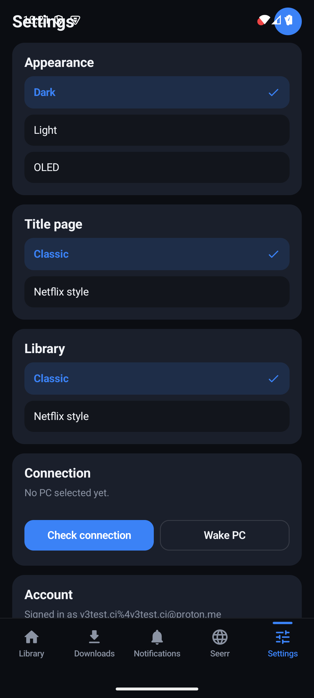
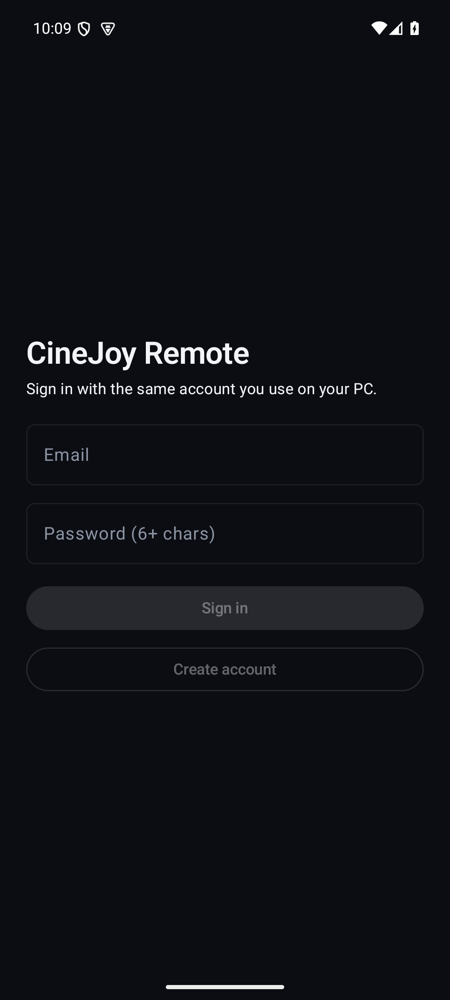

<div align="center">

# 🎬 CineJoy Remote

**Turn your phone into a true remote for the CineJoy desktop downloader.**
Queue movies & series from anywhere, watch download progress live, approve Seerr requests, and browse your PC library — over Supabase, no shared Wi-Fi required.

[](https://github.com/Nidald1/Cinejoy-remote/releases/latest)
[](../../blob/main/.github/workflows/release.yml)
[](#-install)
[](#-license)

**Download · [Latest APK](https://github.com/Nidald1/Cinejoy-remote/releases/latest)** · Setup guide: [PAIRING.md](PAIRING.md)

</div>

---

## 📱 What it does

CineJoy Remote is the companion Android app for the **CineJoy downloader** running on your PC:

- 🏛️ **Library** — full-bleed cinematic hero for your newest titles, section rows, poster grid, add-by-link (cinejoy.pk, movy.sx, akwam, TMDb, IMDb)
- ⬇️ **Downloads** — Active / Failed / Finished pill tabs with live counts, progress, speed & ETA, one-tap retries and bulk purge
- 🔔 **Notifications** — Seerr requests arrive as approvals: Accept imports the title and opens the source & quality picker; Reject declines in Seerr
- 🌐 **Seerr** — the full Jellyseerr/Overseerr web UI in one permanent WebView, fullscreen with a floating app handle
- ⚙️ **Settings** — appearance (Dark / Light / OLED), connection diagnostics with wake-on-LAN, PC tools (logs, engine restart), in-app updates straight from GitHub Releases

<h2 align="center">📷 Screens</h2>

| | | |
|:---:|:---:|:---:|
|  |  |  |
| *Library* | *Downloads* | *Notifications* |
|  |  |  |
| *Seerr (fullscreen)* | *Settings* | *Sign in* |

## ✨ Highlights

- **Design v3** — a single dark-first design system (`#0B0D12` surfaces, one blue accent, 4/8dp grid): 56dp top bar, 40dp underline tabs, 80dp bottom nav, all bars hide-on-scroll
- **Cinematic detail pages** — TMDb-enriched heroes (backdrop, genres, Arabic synopsis, cast) with a sticky action bar
- **Source picker** — accept-then-choose: Cinejoy captured streams (quality variants), Movy servers, or AKWAM entries — the PC does the scraping, the phone picks the quality
- **Realtime mirror** — phone ↔ PC state flows through Supabase Realtime; downloads, requests and events update without polling the PC
- **Smart Seerr tab** — one WebView for the app's lifetime (survives tab switches, rotation and process death), SPA-aware back button, automatic renderer-crash recovery, Tailscale → LAN URL fallback
- **Self-updating** — a silent launch check surfaces new GitHub Releases; download, progress and install happen in-app

## 🛠️ How it works

```
┌───────────┐   realtime ops   ┌──────────────┐           ┌──────────┐
│ CineJoy    │  joins/commands ─▶│   Supabase   │◀── reads ─│ CineJoy  │
│ downloader │─────────────────▶│ Postgres +   │           │  Remote  │
│ (Windows)  │◀── change feed ──│   Realtime   │           │ (phone)  │
└───────────┘                  └──────────────┘           └──────────┘
```

- The **PC app** owns every heavy operation: fetching watch links, resolving TMDb metadata, scraping download sources, running the queue, sending push events
- The **phone** is a pure remote: it mirrors normalized state (shows, episodes, tasks, requests, events) from Supabase and sends commands back
- `supabase/schema.sql` defines the mirror tables + RLS; migrations in `supabase/` stay in sync

## 🖥️ The PC side

Works with the Jellyfin-Enhanced-style CineJoy bridge — the pairing flow is documented in [**PAIRING.md**](PAIRING.md):
1. Install the PC app and sign in with your CineJoy account
2. Install the Android app and sign in with the same account
3. The PC appears automatically; tap it in the phone's profile sheet to start controlling

## 📥 Install

**From a release (recommended)** — grab [`CineDownloader-<version>.apk`](https://github.com/Nidald1/Cinejoy-remote/releases/latest), allow "install from unknown sources" when prompted, done. Every release is built by CI from a clean checkout of a `v*` tag.

**From source**

```bash
git clone https://github.com/Nidald1/Cinejoy-remote.git
cd cinejoy-remote/android
gradle :app:assembleDebug      # SDK 36, JDK 17 required
adb install app/build/outputs/apk/debug/app-debug.apk
```

## 🧱 Project layout

```
cinejoy-remote/
├── android/app/src/main/java/com/nedal/cinejoyremote/
│   ├── ui/v3/         ← design-v3 screens + shell (this redesign)
│   ├── ui/            ← legacy/pre-redesign screens (phased out)
│   ├── presentation/  ← ViewModels (library, downloads, requests, updates…)
│   ├── domain/        ← models + repository interfaces
│   ├── data/          ← Supabase repositories & auth
│   ├── core/          ← Supabase client provider
│   └── update/        ← GitHub-release update checker + APK installer
├── android/app/src/main/java/com/nedal/cinejoyremote/notifications/ ← local push events
├── supabase/          ← schema.sql, migrations, deploy scripts
└── .github/workflows/ ← release.yml: tag → signed APK → GitHub Release
```

### Architecture notes

- Clean MVVM: `V3Shell` (Compose Navigation) → **ViewModels** (`LibraryViewModel`, `DownloadsViewModel`, `RequestsViewModel`, `ShowDetailViewModel`…) → **domain repositories** → Supabase `data/` implementations
- The realtime layer streams inserts per device id; the phone dedupes and raises local notification-channel events
- One Activity, one session-scoped `SeerrSession` ViewModel — WebView state persists through `SavedStateHandle`

## 🚀 Development

| Requirement | Version |
|---|---|
| Android SDK | 36 (compile & target), 26 min |
| JDK | 17 |
| Gradle | 8.13 |

```bash
# full debug APK
gradle :app:assembleDebug
# signed release build (what CI does — needs keystore env vars)
gradle :app:assembleRelease
```

Releases are cut by pushing a tag:

```bash
git tag v5.2.0 && git push origin v5.2.0   # builds + attaches CineDownloader-5.2.0.apk
```

## 🧭 Roadmap

- [ ] "Continue Watching" row (needs playback progress in the mirror schema)
- [ ] Seerr URL override in Settings
- [ ] Tablet / landscape layouts
- [ ] Cast-to-PC handoff from the remote

## 📄 License

Private project — all rights reserved. Not affiliated with Jellyseerr, Overseerr, TMDb, Movy or AKWAM.
